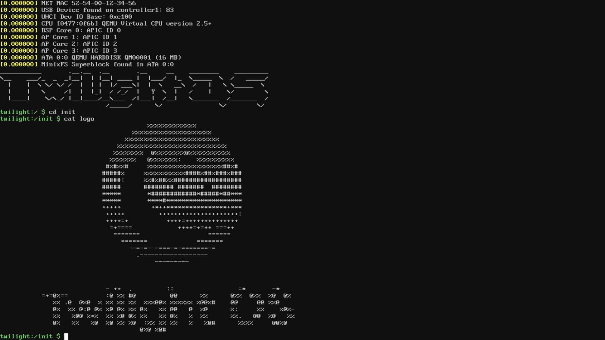
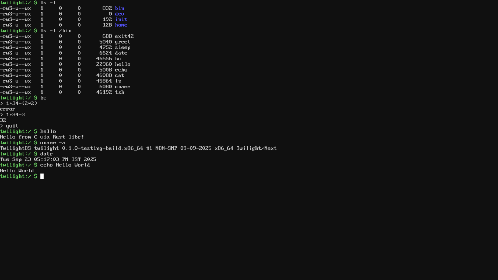
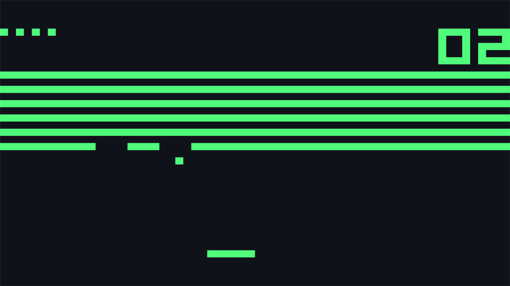
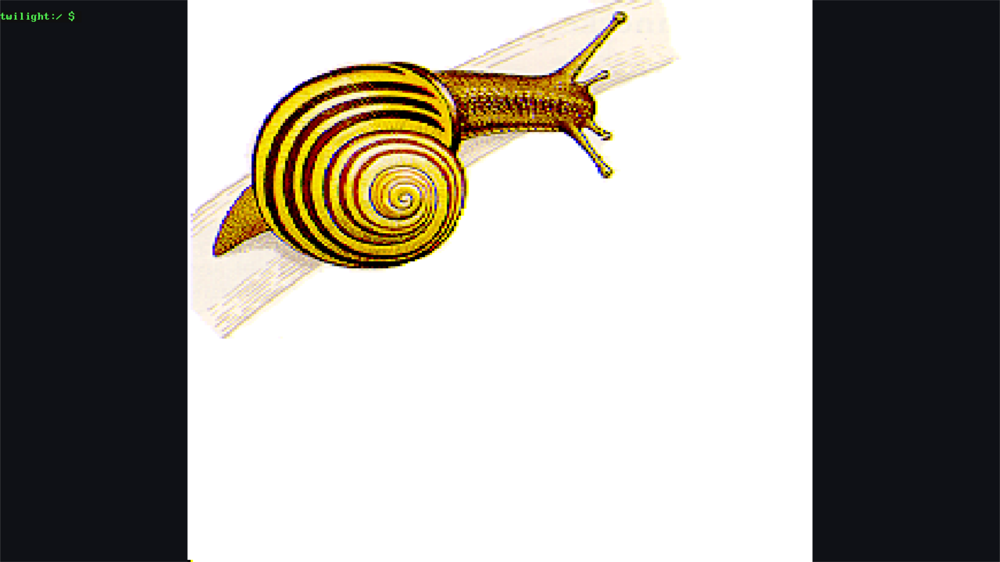
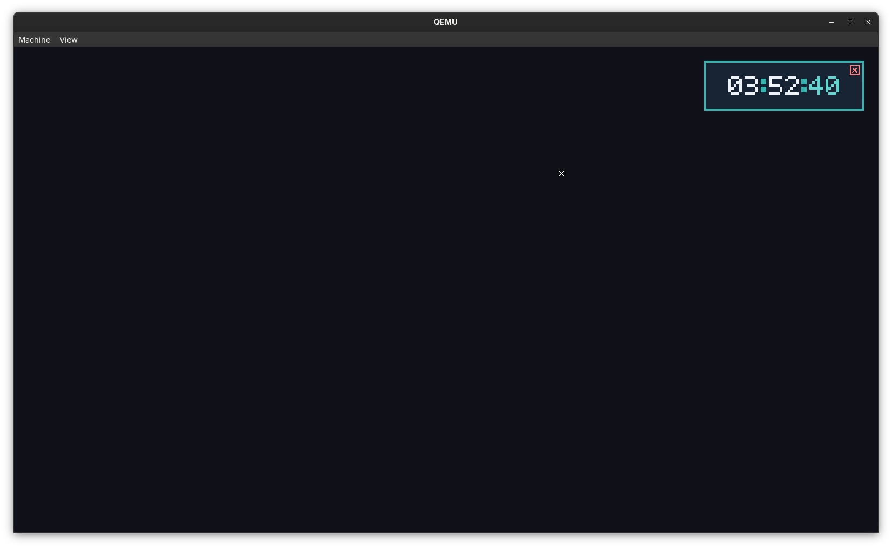
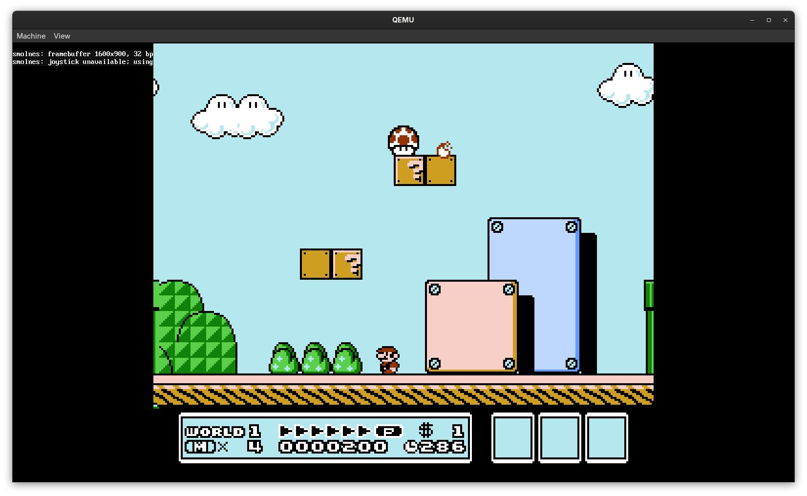

# Twilight OS

## Overview

Twilight OS is a lightweight, Unix-like operating system written in Rust, designed for general-purpose computing, embedded systems, and detailed OS dev learning. It bridges the gap between educational kernels and usable systems by implementing advanced features like dynamic binary loading, a self-hosting C compiler, a custom filesystem, a from-scratch Wayland compositor, and a Linux-style timekeeping subsystem.

It currently targets **x86_64** (Limine boot, UEFI + BIOS).

## Screenshots

<table>
  <tr>
    <td></td>
    <td></td>
  </tr>
  <tr>
    <td></td>
    <td></td>
  </tr>
  <tr>
    <td></td>
    <td></td>
  </tr>
</table>

## Key Features

### Userspace & Tooling
- **Native C Compilation**: Includes `tcc` (Tiny C Compiler) to compile and run C programs directly within the OS (`tcc -run hello.c`).
- **Dynamic Binaries**: Full ELF shared object (`.so`) and dynamic executable support with a kernel ELF loader (PT_LOAD, PT_INTERP, auxv).
- **Scripting**: `tpy`, a Python-subset interpreter, and `bc`, an arbitrary-precision calculator.
- **Shell & Utilities**: `oksh` (pdksh-based shell) and `tsh`, plus coreutils-style `cat`, `grep`, `ls`, `curl`, `vi`, `head`/`tail`, `wc`, `cp`, `mkdir`, `rm`, `touch`, `date`, `uname`, and more.
- **Signals**: Full POSIX signal delivery — `rt_sigaction`, `rt_sigprocmask`, `rt_sigsuspend`, `sigaltstack`, `kill`/`tgkill` — with correct sleep interruption (`-EINTR` + remainder).
- **Init System**: `twinit`, a runit-like PID 1 service manager with TOML service files, restart policies, runlevels, and a control socket (`twinitctl`).
- **Logging**: `twilogd`, a system log daemon collecting structured logs over a Unix-domain socket (`twilogctl` to query/tail).
- **Package Management**: `.ipk` packages via a bundled `opkg`.
- **Wayland Compositor**: `twland`, a from-scratch Wayland compositor speaking raw wire protocol over Unix sockets — xdg-shell toplevel windows, wlr-layer-shell desktop surfaces, SHM buffer compositing to `/dev/fb0`, and real keyboard/mouse input. Includes native clients like `twclock`.
- **Emulators & Games**: Doom (`fbdoom`), a CHIP-8 emulator, and `smolnes` (NES, with absolute monotonic frame pacing). Doom, Smolnes, Snes9x, and third-party library sources are pinned [Git submodules](docs/ports.md). The Snes9x [build wrapper](userspace/apps/snes9x/README.md) requires an Alpine distrobox.

### Kernel & Core
- **Language**: Written in pure Rust (no standard library), `no_std`.
- **Scheduling**: Preemptive userspace scheduling driven by a one-shot LAPIC clockevent with a 10 ms quantum; deferred-reschedule kernel critical sections (`cond_resched()` safe points); experimental kernel-mode preemption implemented but disabled by default. SMP detection with APs parked (BSP-only scheduling for now).
- **Timekeeping**: A Linux-style split between clocksource and clockevent — invariant-TSC or HPET MMIO clocksource (selected at boot, validated) feeding `CLOCK_MONOTONIC`/`CLOCK_REALTIME`; one-shot LAPIC clockevents programming the earliest of the next software deadline or the scheduler quantum; an absolute-deadline min-heap timer queue backing `nanosleep`, `clock_nanosleep`, `poll`/`ppoll`/`select`.
- **Filesystem**: **TwilightFS** (TFS) — a custom bitmap-based filesystem with hot-file caching, efficient directory lookups, extent-based block mapping, and encrypted home directory support. VFS with FAT16, FAT32, ISO9660, ramfs, devfs, and procfs backends.
- **Networking**: Custom network stack (smoltcp) — TCP/UDP, DHCP, DNS — with drivers for RTL8139 and PCNET. Use `curl` to fetch pages or `httpd` to serve them.
- **IPC**: Pipes, Unix-domain sockets (SOCK_STREAM + SOCK_DGRAM, `SCM_RIGHTS` fd passing), `memfd_create` + `mmap MAP_SHARED`, and `futex`.
- **Locking**: IRQ-aware `Mutex` with nest-safe `lock_irq()` (depth-counted interrupt disable), allocation-free `WaitQueue`s, and a documented lock-ordering audit of every IRQ-shared lock.
- **FreeBSD KPI compat layer**: A shim (`compat/freebsd_kpi/`) providing bus_space, bus_dma, callout, taskqueue, and mtx primitives so FreeBSD-style drivers can compile.
- **Drivers**:
    - **Storage**: ATA/IDE with DMA, ATAPI CD-ROM, VirtIO Block.
    - **USB**: UHCI and XHCI host controllers; HID keyboard/mouse and MSC mass storage. [Gamepad support](docs/usb/gamepads.md) remains development work outside `master`.
    - **Input**: PS/2 keyboard & mouse, USB keyboard & mouse.
    - **Network**: RTL8139, PCNET.
    - **Display**: UEFI GOP framebuffer (`/dev/fb0`).
    - **Time**: TSC, HPET, PIT, CMOS/RTC, LAPIC one-shot timer.
    - **Other**: APIC/IOAPIC, UART 16550, PCI enumeration.

## Roadmap & Status

| Feature              | Status           | Details                                                        |
|:---------------------|:-----------------|:---------------------------------------------------------------|
| **Paging & Memory**  | ✅ Done           | Physical/virtual allocation, user/kernel separation, slab+heap  |
| **VFS & TwilightFS** | ✅ Done           | Custom on-disk FS, FAT16/32, ISO9660, devfs, procfs, mount pts |
| **Timekeeping**      | ✅ Done           | TSC/HPET clocksource, one-shot LAPIC clockevents, deadline queue|
| **Dynamic Linking**  | ✅ Done           | ELF loader, shared libraries, auxv, dynamic linker             |
| **Networking**       | ✅ Done           | TCP/UDP stack, DHCP/DNS, `httpd` server, `curl` client         |
| **IPC**              | ✅ Done           | Unix sockets, pipes, memfd, SCM_RIGHTS fd passing, futex       |
| **Signals**          | ✅ Done           | `rt_sigaction`/sigprocmask/sigsuspend, kill/tgkill, EINTR      |
| **Userspace**        | ✅ Done           | `tcc`, `tpy`, `bc`, `vi`, `oksh`, emulators, compositor        |
| **Multitasking**     | 🚧 Beta          | Preemptive userspace scheduling; deferred-reschedule kernel; SMP detection (APs parked) |
| **Graphics**         | 🚧 Experimenting | Wayland compositor (xdg-shell + layer-shell), framebuffer      |
| **Package Mgmt**     | 🚧 Beta          | `.ipk` packages via bundled `opkg`                             |
| **Doom**             | ✅ Done           | Doomgeneric framebuffer and input port, pinned as a submodule                |

## Build Instructions

### ✅ Requirements

- **Rust** (nightly, pinned in `kernel/rust-toolchain.toml`)
- Rust stable with the `x86_64-unknown-linux-musl` target for userspace
- `llvm-tools-preview`
- `nasm`, `ld` (binutils), `xorriso`
- `qemu` (emulator)
- `musl-gcc` (for userspace LibC)
- `cpio` (initramfs)
- Meson, Ninja, pkg-config, a host C compiler, and Expat development headers for Wayland libraries/clients
- `sgdisk` (gdisk) and mtools for HDD images
- Autoconf, Automake, and Libtool to bootstrap the libffi source submodule
- The [Alpine distrobox for Snes9x](userspace/apps/snes9x/README.md)

### ✅ Quick Start

1. **Install Dependencies** (Ubuntu/Debian example):
   ```bash
   sudo apt install build-essential nasm qemu-system-x86 xorriso musl-tools cpio git curl gdisk mtools meson ninja-build pkg-config libexpat1-dev autoconf automake libtool
   git clone --recurse-submodules https://github.com/akashKarmakar02/twilight_os.git
   cd twilight_os
   # For an existing checkout: git submodule update --init --recursive
   rustup toolchain install stable
   rustup toolchain install nightly-2025-06-01 --component llvm-tools-preview --target x86_64-unknown-none
   rustup target add --toolchain stable x86_64-unknown-linux-musl
   ```

2. **Build & Run**:
   ```bash
   make run
   ```
   *This downloads necessary bootloader files (Limine) and OVMF firmware automatically.*

3. **First Boot**:
   The ISO provides a live system. To install onto a new development data disk
   for persistent TwilightFS storage, run inside the guest (this initializes
   the target disk):
   ```bash
   install
   ```
   Then reboot to use the persistent TwilightFS.

### Other useful targets

| Target              | Description                                                        |
|:--------------------|:------------------------------------------------------------------|
| `make run-x86_64-uefi` | Boot via OVMF UEFI firmware                                    |
| `make run-bios`     | q35 machine, BIOS boot                                            |
| `make run-blk-bios` | virtio-blk + qemu-xhci                                            |
| `make kernel`      | Build the kernel only                                             |
| `make userspace`   | Build libraries/apps and stage rootfs executables                 |
| `make test-tty`    | Host framebuffer-terminal regression tests                        |
| `make test-net`    | Snapshot QEMU networking and IPC regression                       |
| `make test-time`    | Non-destructive headless timing regression matrix (no disk write) |
| `make all-hdd`      | Build a GPT HDD image instead of an ISO                           |

## Userspace Highlights

The `userspace/` builder detects Makefile, Cargo, Zig, or plain C projects and stages executables into `rootfs/bin/`. Most programs link statically against musl; Wayland clients and the Snes9x port also use shared libraries from the rootfs sysroot.

- **`tcc`**: The compiler. Try `tcc -run hello.c`!
- **`twland`**: The Wayland compositor — xdg-shell windows, layer-shell desktop surfaces, SHM rendering.
- **`twinit`**: PID 1 service manager supervising `twilogd`, `httpd`, `twland`, and more.
- **`httpd`**: A non-blocking HTTP server serving `/var/www`.
- **`smolnes` / `fbdoom` / `chip8`**: Emulators and games running on the framebuffer.
- **`snes9x`**: SNES framebuffer port in a source submodule; see its [build prerequisites](userspace/apps/snes9x/README.md).
- **`clockcheck`**: Guest-side timing probe paired with the `tools/time-regression/` host harness.

## Documentation

Start with the [documentation index](docs/README.md) for [build instructions](docs/build-system.md), [QEMU networking and host file transfers](docs/development.md), [timekeeping](docs/timekeeping.md), [kernel locking](docs/kernel-locking.md), [TTY behavior](docs/console.md), [init and services](docs/system/twinit.md), [Wayland](docs/system/twland_wayland_transport.md), and [filesystem internals](docs/filesystem/).

View the documentation online at [https://twilight-os.vercel.app](https://twilight-os.vercel.app).

## License

Twilight OS is licensed under the BSD-3 Clause License. See the [LICENSE](LICENSE) file for details.
